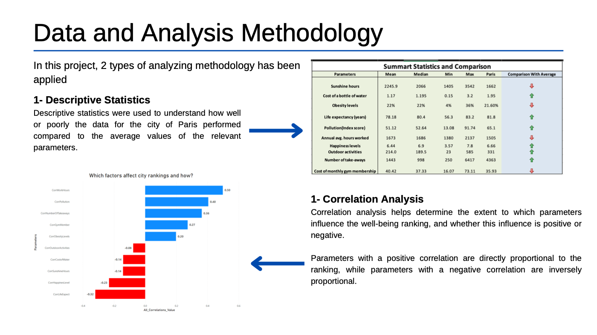
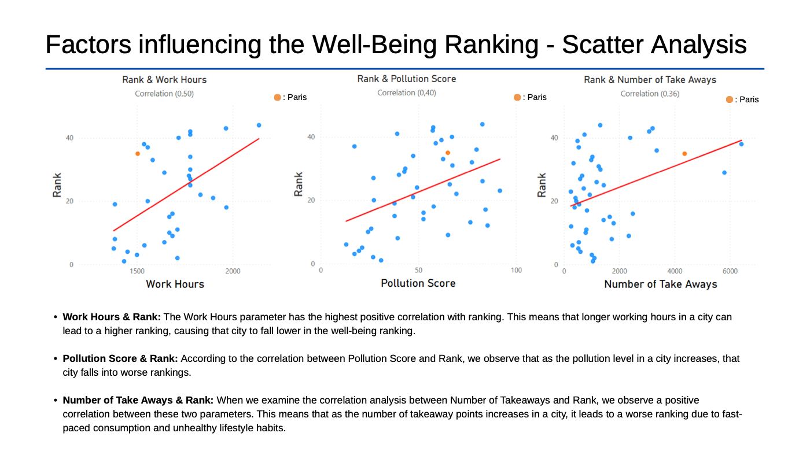
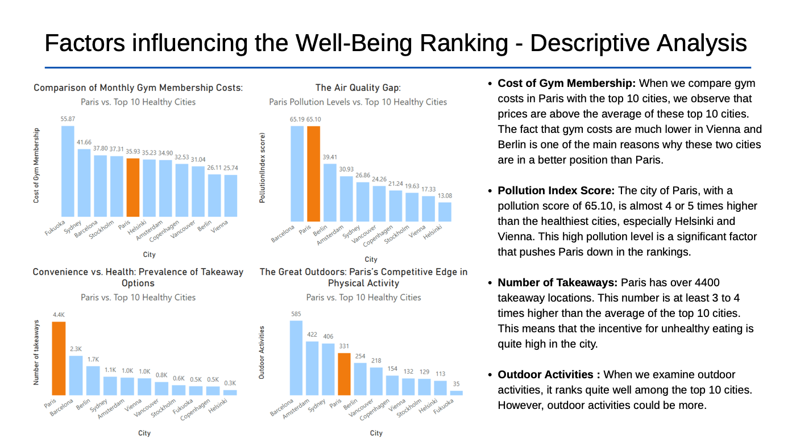
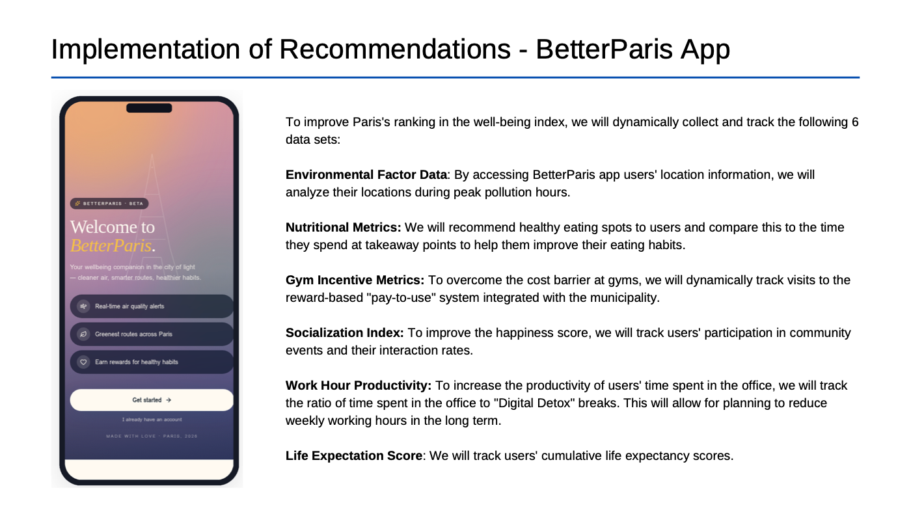
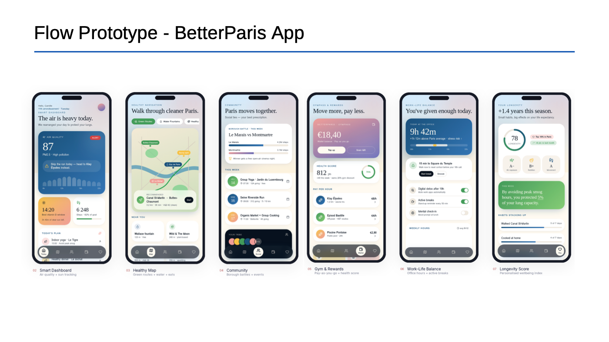

<div align="center">

# 🗼 Health & Wellbeing Trends in Global Cities
### A Data-Driven Analysis of Paris's Performance


</div>

---

## 📌 Business Problem

Paris is widely seen as a world capital of culture, art and modern living, yet it ranks only **35th out of 44 global cities** on the Healthy Lifestyle / Wellbeing Index.

**Goal:** find out *which factors* pull Paris down compared with the world's healthiest cities, and turn those insights into an **actionable, data-driven solution** that makes Paris more livable.

## 🎯 Key Results at a Glance

| Metric | Paris | Top-10 Healthy Cities | Insight |
|---|---|---|---|
| 🏭 Pollution Index | **65.1** | 13–39 | ~4–5× higher than Helsinki & Vienna |
| 🍔 Takeaway outlets | **4,363** | 0.3K – 2.3K | 3–4× the top-10 average |
| 🏋️ Monthly gym cost | **£35.93** | £25.74 – £55.87 | Mid-range, but a *controllable* lever |
| 🌳 Outdoor activities | **331** | 35 – 585 | A competitive strength |

## 🔬 Methodology



1. **Descriptive statistics:** mean, median, min and max for 10 wellbeing parameters, with Paris benchmarked against the averages.
2. **Correlation analysis:** measures how strongly, and in which direction, each parameter affects a city's wellbeing **rank**.

| Strongest *negative* drivers (push rank down) | r | Strongest *positive* drivers (lift rank up) | r |
|---|---|---|---|
| Annual work hours | +0.50 | Life expectancy | −0.32 |
| Pollution score | +0.40 | Happiness level | −0.23 |
| Number of takeaways | +0.36 | Sunshine hours | −0.14 |
| Gym membership cost | +0.27 | Cost of a bottle of water | −0.14 |

> A higher rank number means a worse position, so a positive correlation hurts the city.

## 📊 Analysis

### Scatter analysis: what drives the ranking?


### Paris vs. the Top-10 healthiest cities


## 💡 Recommendation: *BetterParis* App

To turn these insights into action, I designed **BetterParis**, a wellbeing companion app that collects and tracks **6 dynamic datasets**:

| Data stream | Purpose |
|---|---|
| 🌫️ **Environmental Factor Data** | Route users away from peak-pollution zones and hours |
| 🥗 **Nutritional Metrics** | Recommend healthy eateries and reduce time spent at takeaways |
| 🏋️ **Gym Incentive Metrics** | A municipality-backed *pay-to-use* reward system that removes the cost barrier |
| 🤝 **Socialization Index** | Community events that raise the happiness score |
| ⏱️ **Work-Hour Productivity** | Office time vs. "digital detox" breaks |
| ❤️ **Life Expectation Score** | A cumulative, personal longevity score |




## 📁 Repository Structure

```
├── dashboard/   paris-wellbeing-dashboard.pbix   → Interactive Power BI dashboard
├── report/      paris-wellbeing-report.pdf       → Full presentation (11 slides)
├── data/        healthy-cities-dataset.xlsx      → Dataset & preprocessing
└── images/                                       → Visuals used in this README
```

## 🚀 How to Explore

1. Download [`dashboard/paris-wellbeing-dashboard.pbix`](dashboard/paris-wellbeing-dashboard.pbix) and open it with **[Power BI Desktop](https://powerbi.microsoft.com/desktop/)** (free).
2. Or read the full story in the [📄 PDF report](report/paris-wellbeing-report.pdf).

## 🛠️ Skills Demonstrated

`Data Cleaning` · `Descriptive Statistics` · `Correlation Analysis` · `Benchmarking` · `Data Visualization` · `Power BI` · `Business Recommendation` · `Product Thinking`

---

<div align="center">

👤 **Yasin Topal** · Master of Data Analytics portfolio project

⭐ If you found this project interesting, consider giving it a star!

</div>
